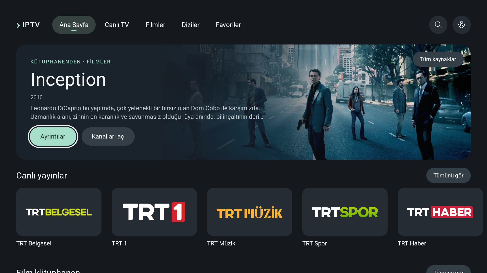
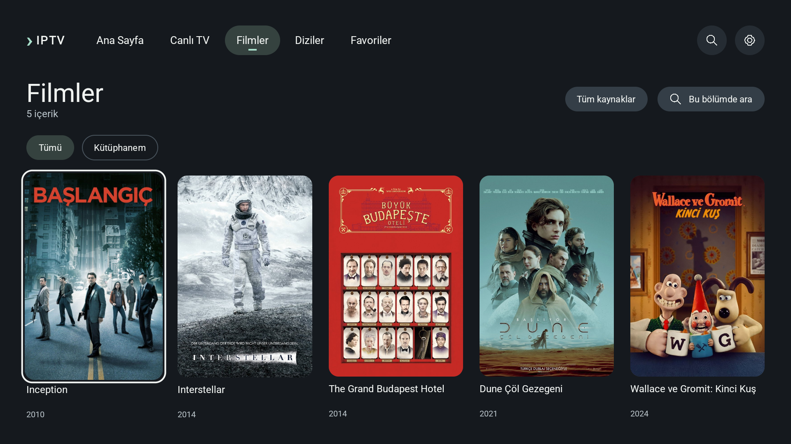
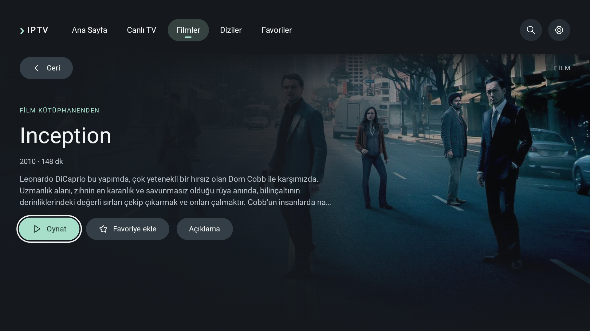
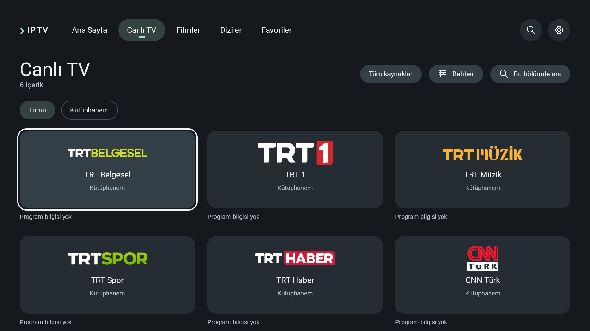
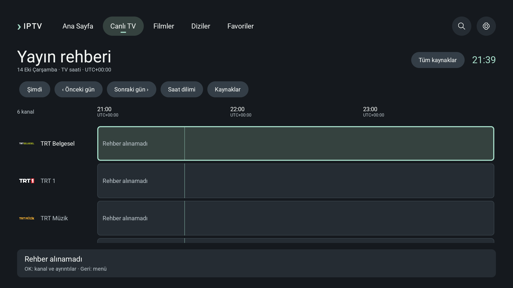
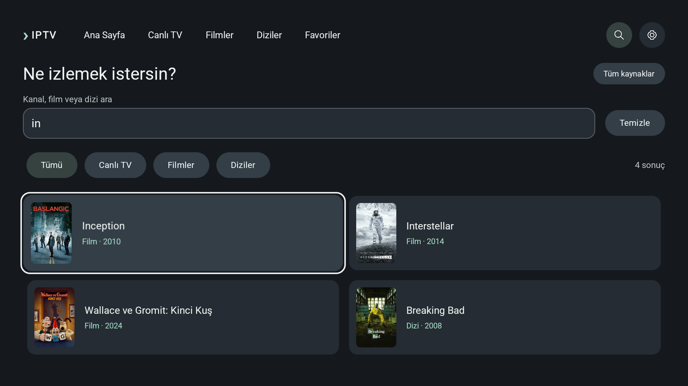

# Akış boyunca görsel inceleme · 15 Ekim 2026

0.14.10 çalışma adayı, yalnız ayrılmış tasarım emülatöründe. Görseller mevcut test paketindeki gerçek afiş/logolarla oluşturuldu; sağlayıcı hesabına bağlanılmadı. Bu değerlendirme kullanıcı onayı veya fiziksel TV performans ölçümü değildir.

**Güncelleme:** Rehber logo sorunu0.14.10tesliminde düzeltildi; [yeni kanıt](GUIDE_LOGOS.md). Aşağıdaki görseller önceki inceleme anını gösterir.

## Görsel değerlendirme

- Ana sayfa: ortak32dp kenar, yüzleri koruyan arka plan ve beş kanal kartı görünür. Altta sıradaki rafın başlangıcı kısmen görünür; odaklı kart testi tam sınırı kontrol eder.
- Filmler: beş afişin oranı korunur, başlık ve yıl aynı tabanda. Uzun adlar ekran genişliğini yönetir; odak çerçevesi kesilmez.
- Detay: arka plan/metin ayrımı ve oynat/favori/açıklama hiyerarşisi okunaklı. Önceki uzun açıklama okuyucusu korunur.
- Canlı TV: üç sütun ve ortak yüzeyler tutarlı. Kanal logolarının doğal oranı nedeniyle optik büyüklükleri farklı; germe yapılmamalı.
- Arama: sonuçların metin/afiş ilişkisi ve iki sütun düzeni ana sistemle uyumlu. Çoklu kaynak uzun etiketleri ayrıca izlenecek.
- **Öncelikli sorun — rehber:** uzun kanal logoları normalde36dp kare, büyük yazıda28dp kare içine sığıyor; TRT Belgesel gibi yatay logolar çok küçük. Kanal sütunu ve logo kutusu birlikte yeniden düzenlenmeli. Program alanı ve uzun kanal adı okunabilirliği korunmalı; üç fontta kumanda testi gerekli.

## Güncel görüntüler

## Figma doğrulaması

Kişisel fyzcbn hesabı whoami ile yeniden doğrulandı.204:32 için screenshot isteği Starter MCP kotası nedeniyle reddedildi. Bu bir erişim hesabı belirsizliği değildir; güncel Figma görüntüsü alınamadı. Manifest ve Figma değiştirilmedi. Eşleme tamamlanmış sayılmaz.
