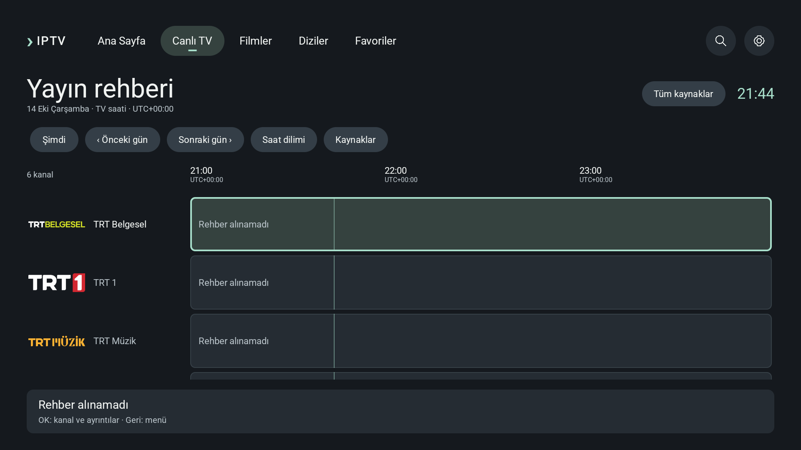
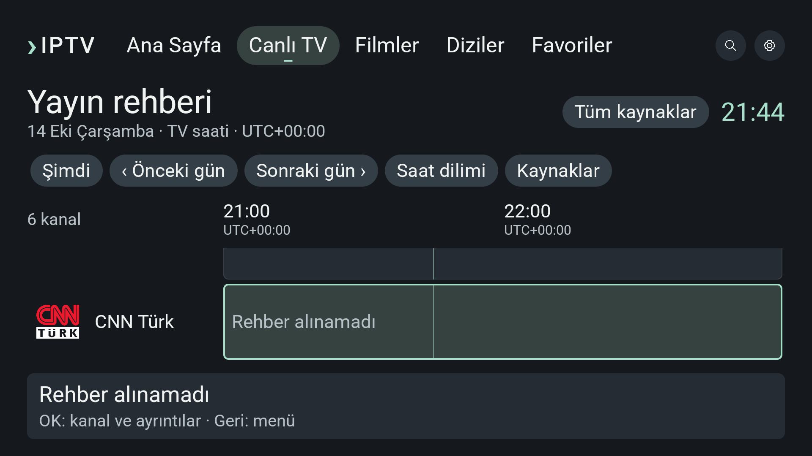
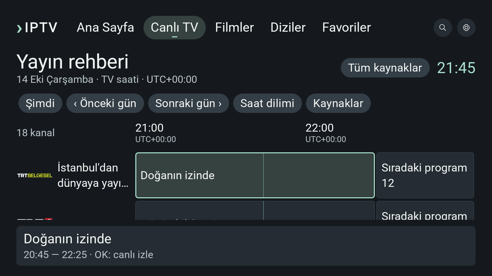

# Rehberde kanal kimliği · 0.14.10

Önceki küçük kare logo alanı yatay markaları okunamayacak kadar küçültüyordu. Logo alanı artık72dp genişliğinde; normal yazıda40dp, büyük yazıda44dp yükseklikte. İç pay2dp; mevcut Artwork contain davranışı korunur. Kanal sütunu normal196dp, büyük yazıda232dp. Logo büyürken ad için de önceki alandan az yer bırakılmaz. Program alanı kalan genişliği kullanır; zaman/gezinme modeli değişmedi.

## Doğrulama

Güncellenmiş VisualPreview testi altı kanalı gerçek aşağı tuşlarıyla dolaşır; her seçili satır ve logo sınırını,72dp genişliği, altı benzersiz kanala erişimi doğrular. TRT Belgesel gibi geniş ve CNN Türk gibi kare görseller incelendi. GuideFlow uzun kanal adı, program ayrıntısı, saat dilimi, kaynak rehber ayarları ve URL düzenleyici erişimini kontrol eder. İki vaka normal,1.5,2.0fontta geçti.

İlk2.0testi ekran dışında henüz oluşturulmamış üçüncü satırı ölçmeye çalışıyordu. Test her satıra kumandayla giderek ölçer hale getirildi; üretim hatası olarak raporlanmaz. İlk başarısız log özel çalışma alanında korundu.

Son normal fontta PilotFlow ve farklı uzunluktaki programlarda zaman konumunu koruyarak ayrıntı/oynatıcıdan dönüş testi2/2geçti. Lint0hata/32uyarı; v2imza doğrulandı. JVM bu UI turunda tekrarlanmadı. [QA](../project/native-guide-logo-qa.json).

Bu kanıt fiziksel TV okunabilirliği/performans veya Figma eşleşmesi değildir. Yayın rehberinin olmadığı artwork örnekleri bilgi yok durumudur; programlı örnekler yerel test verisidir.
