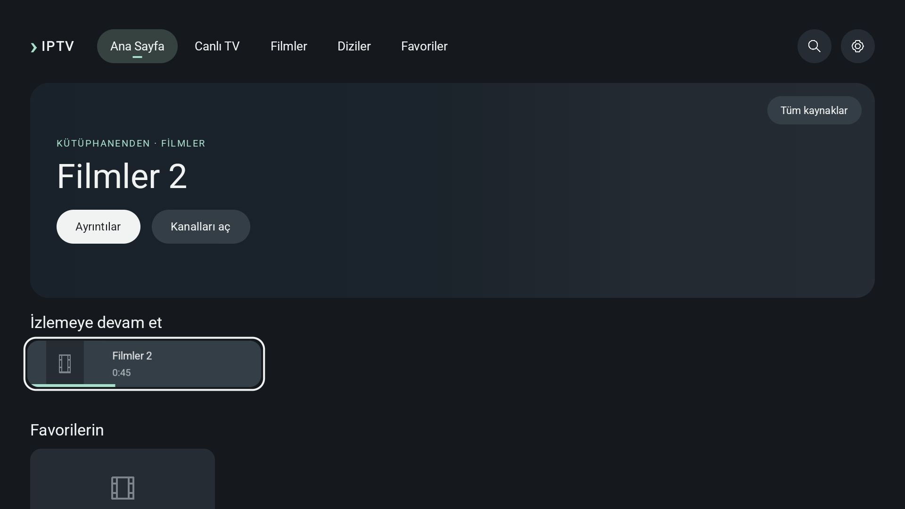

# Büyük katalog ve yeniden açılış · 15 Ekim 2026

0.14.10 debug APK, yalnız ayrılmış emülatör. Üretim kodu ve APK değişmedi. Gerçek sağlayıcı kullanılmadı. Bu sonuçlar PRD fiziksel performans kabulü değildir.

## 60 bin kayıt

10bin canlı kanal,35bin film,15bin dizi. Mevcut LargeCatalogProbeTest geçti;24sorgu ve5yeniden yükleme örneği. Türkçe büyük/küçük harf, dar ve60bin sonuçlu sorgular dahil.

| Tanı | Ölçüm |
| --- | --- |
| Şifreli katalog yazımı | 2044 ms |
| Yeniden yükleme → görünür ana sayfa | 2766–3081 ms; medyan 2883 ms |
| Sorgu → görünür sonuç | 165–911 ms; medyan 200 ms |
| İlk sorgu | 911 ms |
| Son Java heap örneği | 85.2 MiB; tepe veya toplam süreç belleği değil |

Bu süreler test senkronizasyonu/Compose idle beklemesini içerir. Yeniden yüklemeler aynı uygulama sürecindedir; soğuk açılış olarak adlandırılmaz. 60bin veri, PRD'deki10bin kanallı fiziksel arama kabul senaryosuyla aynı koşul değildir.

## Süreç yeniden başlatma

CatalogColdLaunchTest63.175kayıt, bir favori,45.000ms ilerleme ve izlemeye devam et geçmişi hazırlar. Harici force-stop sonrası am start -W COLD döndü; Activity toplamı2627ms. Bu değer içerik hazır olma süresi değildir. Sekiz saniye sonra UI ağacında İzlemeye devam et bulundu ve görüntü alındı.

Ayrı instrumentation sürecindeki doğrulayıcı seedPID'den farklı PID'yi zorunlu tutar; yeni Activity/ViewModel'de tam63175kayıt, kaynak, favori, ilerleme ve devam rafı kaydı doğrulandı. Bu ikinci açılışta model hazır olma ölçümü4472ms; instrumentation içerdiğinden ilk harici açılışla birleştirilmez. Son temizleme testi geçti.

## Tekrarlama

Önce assembleDebugAndroidTest ile test APK'sini derle; test edilen uygulama APK'sinin hedef emülatörde kurulu olduğunu doğrula. [Araç](../../tools/check_cold_catalog.py) --adb, --serial ve --allow-fixture-reset ister. Yalnız nextv_design_api36 AVD'sine izin verir; fiziksel seri reddi de denendi. Seçili test cihazındaki kaynakları siler ve sonunda fixture'ı temizler; kullanıcı TV'sinde çalıştırılmaz. Varsayılan çıktı.private/cold-catalog-audit.

Araç taşınırken log dizini ile sonuç bytes değişkeni aynı adı kullandığı için ilk deneme rapor yazımında başarısız oldu; isim ayrıldı ve paylaşılan araç uçtan uca geçti. Uygulama hatası değildir.

## Sonraki inceleme

Yeniden yükleme ve ilk arama gecikmesini bileşenlerine ayır: şifreli okuma/çözme, katalog decode, SourceLibrary.combine, arama indeksi ve ilk UI yerleşimi. Önce profil çıkar; sayıları hızlandırmak için kalıcılık veya hata güvenliğini gevşetme. Fiziksel kumanda/ilk kare/codec/uzun oynatma ve kullanıcı görsel kabulü açık.
